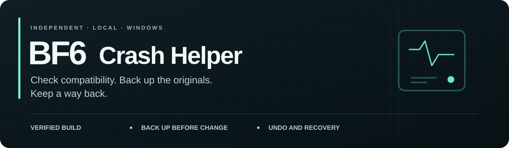
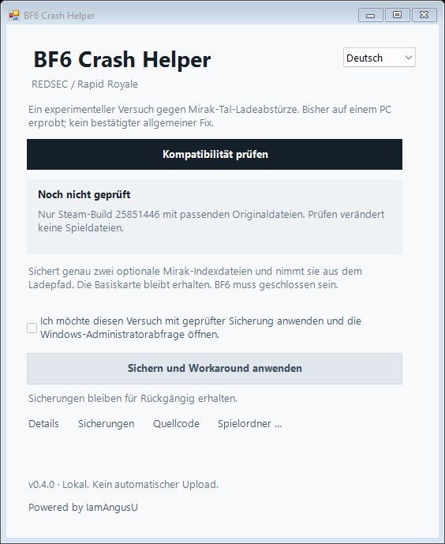

<p align="center"><a href="https://github.com/IamAngusU/bf6-crash-helper"></a></p>

<p align="center"><a href="README.md">English</a> · <a href="#loslegen">Loslegen</a> · <a href="docs/README.md">Dokumentation</a> · <a href="https://github.com/IamAngusU/bf6-crash-helper/releases/tag/v0.4.0">Download</a></p>
<p align="center"><a href="docs/privacy.md"></a> <a href="docs/rapid-workaround.md"></a> <a href="LICENSE"></a></p>

**Ein kleines Fenster für den REDSEC-Rapid-Royale-/Mirak-Tal-Workaround und seine Rücknahme.** Englisch ist voreingestellt; oben kannst du Deutsch wählen. Kein Installer, Git, Python, Node oder Paketmanager nötig.

**Experimentell; nur Steam-Build 25851446.** Nach der Zwei-Dateien-Änderung gelangen auf dem untersuchten PC mehrere Beitritte. Mit dem offiziellen Update allein trat derselbe Absturz noch auf. Das ist kein allgemein bestätigter Fix. Direkter Nachweis des Basiskarten-Fallbacks und breitere Tests fehlen. [Befunde und Grenzen](docs/case-evidence.md).



## Loslegen

<a href="https://github.com/IamAngusU/bf6-crash-helper/releases/tag/v0.4.0"></a>

**Eine Zeile in PowerShell:**

```powershell
& { $ErrorActionPreference='Stop'; $p=Join-Path $env:TEMP ('BF6CrashHelper-'+[guid]::NewGuid().ToString('N')+'.exe'); Invoke-WebRequest -UseBasicParsing 'https://github.com/IamAngusU/bf6-crash-helper/releases/download/v0.4.0/BF6CrashHelper.exe' -OutFile $p; if((Get-FileHash -LiteralPath $p -Algorithm SHA256).Hash -ne '1f66a08fdeee24ba3295f707b8494c5639b4e6f6bd0fa48294a25733b71d2d81'){throw 'SHA-256 mismatch; do not run this download.'}; Start-Process -FilePath $p }
```

Die Zeile lädt die festgelegte EXE v0.4.0, prüft SHA-256 und öffnet das Fenster. Sie verändert nichts am Spiel und fordert keine Administratorrechte an. Prüfe vor dem Ausführen den [lesbaren Starter](https://github.com/IamAngusU/bf6-crash-helper/blob/v0.4.0/start.ps1), den [Änderungs-/Rücknahmecode](https://github.com/IamAngusU/bf6-crash-helper/blob/v0.4.0/src/MirakRecovery.cs) und den [Administrator-Worker](https://github.com/IamAngusU/bf6-crash-helper/blob/v0.4.0/src/MirakWorker.cs). Öffentlicher Code und passende Prüfsumme sind kein Sicherheitsversprechen.

Alternativ **BF6CrashHelper.exe** aus [dem Release](https://github.com/IamAngusU/bf6-crash-helper/releases/tag/v0.4.0) herunterladen und doppelklicken. Benötigt Windows 10/11 x64 mit .NET Framework 4.8. Die EXE ist unsigniert; Windows-Schutz aktiviert lassen und selbst über das Vertrauen in Quelle und Build entscheiden.

1. BF6 regulär schließen und **Kompatibilität prüfen** wählen. Der Steam-Spielordner wird automatisch gesucht; bei Bedarf **Spielordner …** verwenden.
2. Umfang lesen. Nur der geprüfte Build mit passenden Originalhashes für EXE, Layout, Basiskarte und die optionalen Indizes wird unterstützt.
3. Das nicht vorausgewählte Zustimmungsfeld aktivieren und **Sichern und Workaround anwenden** wählen. Erst dann öffnet sich UAC. Dafür dasselbe Windows-Konto verwenden.
4. Mehrere relevante Rapid-Beitritte testen. Zum Zurückrollen BF6 schließen und den Helper erneut öffnen. **Workaround rückgängig machen** erscheint an derselben Stelle mit eigener Zustimmung. Die geprüften Backups bleiben erhalten.

## Schon angewendet?

Beim erneuten Öffnen findet die App ihren gespeicherten Vorgang und prüft aktuellen Build, geschützte Dateien, Indexdateien und benötigte Sicherungen. **Workaround bereits angewendet** bedeutet, dass die protokollierte Änderung weiterhin besteht und Rückgängig verfügbar ist. Erneutes Anwenden bleibt gesperrt. Vorhandene Workaround-Protokolle aus v0.2/v0.3 bleiben kompatibel.

Hat Steam die Originale wiederhergestellt, erscheint **Originale bereits wiederhergestellt**. **Wiederherstellung abschließen** prüft sie und schließt den gespeicherten Vorgang ab. Nach einem Update bleiben aktuelle Dateien erhalten; alte Backups werden nicht in einen neuen Build eingefügt. Teilweise Änderungen lassen sich wiederherstellen; Konflikte oder defekte Backups blockieren den Vorgang. [Fehlerverhalten](docs/rapid-workaround.md).

Fehlen optionale Dateien ohne passendes App-Protokoll, erscheint **Dateien fehlen ohne bekannte Sicherung**. Das ist kein Fixnachweis. Die App erfindet keine Sicherung und kann nicht feststellen, wer die Dateien entfernt hat. Originalbackup behalten oder Steams Dateiprüfung für aktuelle Originale verwenden.

## Genauer Umfang

Genau die optionale SAN2-Mirak-TOC und Digest werden gesichert und aus dem Ladepfad genommen. Beide Backups müssen dauerhaft gespeichert und geprüft sein, bevor die erste Originaldatei entfernt wird. Die Basiskarte bleibt erhalten. Laufendes BF6, unbekannter Build, veränderte geschützte Dateien, verknüpfte Pfade oder Dateikonflikte stoppen Änderungen. [Dateipfade, Prüfungen und Rücknahme](docs/rapid-workaround.md).

Version 0.4 enthält **nur den Workaround und seine Wiederherstellung**. Allgemeine Diagnose, Dump-Leser, Cache-Aktionen und Windows-Recorder wurden aus der EXE entfernt. Es gibt keine More-tools-Seite und keinen Aufzeichnungs-Worker. Kontoberechtigungen, Spieleinstellungen und Anti-Cheat-Dateien werden nicht verändert. Battlefield zu kaufen ist kein vorgeschlagener Fix.

Kein automatischer Upload. **Details**, **Sicherungen** und **Quellcode** erklären den Vorgang. **Powered by IamAngusU** im Fußbereich verlinkt dieses Repository. [Datenschutz](docs/privacy.md) · [Forentext Deutsch / Englisch](docs/forum-post.md).

## Prüfung und Rückmeldung

Entwickler: `./build.ps1 -Test` unter Windows. Der Build nutzt eine feste Liste ausschließlich für diesen Workaround benötigter Quelldateien. Getestet werden Anwenden/Rückgängig, Abbrüche, Updates, Konflikte, beschädigte Backups, Verknüpfungen, gleichzeitige Vorgänge, einmalige Worker-Anfragen, Wiedererkennung und Zustimmung/Sprachumschaltung. Ein Test prüft zusätzlich, dass Diagnose-, Cache- und Recorder-Typen fehlen. Die Tests verwenden künstliche Bibliotheken, ohne echtes Spiel zu verändern, UAC zu bestätigen oder ETW zu starten. Jeder Release nennt die tatsächlich erfolgte Prüfung und CI-Grenzen.

Melde Build, Modus/Karte soweit bekannt und den sichtbaren Status über [GitHub Issues](https://github.com/IamAngusU/bf6-crash-helper/issues). Spieldateien, Backups, Dumps und private Logs gehören nicht in öffentliche Issues.

---

Powered by [IamAngusU](https://github.com/IamAngusU). [MIT](LICENSE). Unabhängiges Community-Projekt, ohne Verbindung zu EA, DICE, Battlefield Studios oder Valve.
