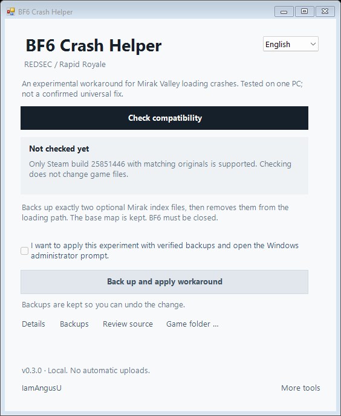

<p align="center"><a href="https://github.com/IamAngusU/bf6-crash-helper"></a></p>

<p align="center"><a href="README.de.md">Deutsch</a> · <a href="#quick-start">Quick start</a> · <a href="docs/README.md">Documentation</a> · <a href="https://github.com/IamAngusU/bf6-crash-helper/releases">Releases</a></p>

<p align="center">
  <a href="docs/privacy.md"></a>
  <a href="docs/rapid-workaround.md"></a>
  <a href="LICENSE"></a>
</p>

Battlefield closes while you join Rapid Royale. **BF6 Crash Helper** offers a build-specific, reversible Mirak Valley workaround, alongside local diagnostics. Every change needs your explicit choice.

**Experimental, not a confirmed universal fix.** Several joins worked on the investigated PC after the two-file workaround. The official update alone had still crashed with the same signature. Direct proof of the base-map fallback and broader testing remain incomplete. [Evidence and limits](docs/case-evidence.md) · [Exact changes and rollback](docs/rapid-workaround.md).

## Quick start

One compact window, inspired by the author's [Gaze Lab interface](https://github.com/IamAngusU/CS2GazeLab/blob/main/Licensing/LicenseGateWindow.xaml). **English is the default**, with a live **Deutsch** switch. Compatibility, explicit consent and Apply/Undo stay in the same surface. Optional diagnostics are behind **More tools**.



<a href="https://github.com/IamAngusU/bf6-crash-helper/releases/tag/v0.3.0"></a>

**One line in PowerShell, with no Git, Python, Node or package manager:**

```powershell
& { $ErrorActionPreference='Stop'; $p=Join-Path $env:TEMP ('BF6CrashHelper-'+[guid]::NewGuid().ToString('N')+'.exe'); Invoke-WebRequest -UseBasicParsing 'https://github.com/IamAngusU/bf6-crash-helper/releases/download/v0.3.0/BF6CrashHelper.exe' -OutFile $p; if((Get-FileHash -LiteralPath $p -Algorithm SHA256).Hash -ne '308dc04afd412e512b1ad2fae7f010bad5dc40c559946e0b51a5bb0f9a2322fd'){throw 'SHA-256 mismatch; do not run this download.'}; Start-Process -FilePath $p }
```

This downloads **v0.3.0**, checks its pinned SHA-256 and opens the app. It does **not** apply a workaround, request administrator rights or disable PowerShell/Windows protection. Review [the readable launcher](https://github.com/IamAngusU/bf6-crash-helper/blob/v0.3.0/start.ps1), [the workaround code](https://github.com/IamAngusU/bf6-crash-helper/blob/v0.3.0/src/MirakRecovery.cs) and [the elevation worker](https://github.com/IamAngusU/bf6-crash-helper/blob/v0.3.0/src/MirakWorker.cs) **before running it**. A matching hash establishes which release you downloaded, not that code is safe.

Prefer a normal download? Open [v0.3.0](https://github.com/IamAngusU/bf6-crash-helper/releases/tag/v0.3.0), download **BF6CrashHelper.exe**, and double-click it.

1. Close Battlefield normally. Choose **Check compatibility**. The Steam folder is detected automatically; **Game folder …** lets you select it if needed.
2. Read the exact scope and backup location. The initial release of this workaround only supports **Steam build 25851446**, with matching original EXE, layout, base-map and two SAN2 index hashes, on a local NTFS library.
3. Tick the unchecked consent box and choose **Back up and apply workaround**. Only this explicit choice opens the administrator prompt. Use the same Windows account for elevation.
4. Test several relevant Rapid joins. If it does not help, close BF6 and reopen the helper. Its recorded change brings **Undo workaround** into the same action area, with separate, unchecked consent. Interrupted operations use this recovery path too.

Opening the app performs no game scan, modification or upload. Reading its own local recovery/capture history makes interrupted operations reachable again. Steam verification may re-download the two optional indexes; check compatibility again rather than forcing a new build.

For Windows 10/11 (x64) with .NET Framework 4.8 available. No separate runtime is needed on a current supported Windows installation. The release executable is unsigned: if Windows shows SmartScreen, review the publisher/source and file before deciding whether to open it. Keep Windows protection enabled.

Ordinary scans run without administrator rights. The Rapid workaround and its undo need permission to change the two Steam files; the separate Windows file trace has its own consent and administrator prompt. **More tools** opens these optional diagnostics; opening it starts no scan, recording or change.

## Choose the next step

- **Scan:** inspect installation and existing crash metadata, plus selected files against available local Steam manifests. This is a targeted check, not a full Steam verification.
- **Rapid workaround:** verify the exact supported build, durably back up both optional SAN2 Mirak indexes before removing either original, and retain recovery history. Unknown builds, changed files, linked paths and a running game stop the operation. Undo preserves backups and refuses to overwrite changed originals. [Failure and update behavior](docs/rapid-workaround.md).
- **Save a report:** create a local, sanitized summary you can review before sharing. Nothing is uploaded automatically.
- **Try a cache reset:** close Battlefield first, explicitly confirm the test, and retain the previous cache as a backup. Steam may stay open. Undo preserves any rebuilt cache too.
- **Start Steam verification:** an additional OK/Cancel dialog explains that Steam may download original files again. Only confirming starts it; the helper cannot undo Steam's changes.
- **Record a short file trace:** separately opt in to a timed Windows recording. Its private ETL can contain file paths and process information and stays outside the share report.

If Windows cannot confirm that a recording stopped, the app shows **Cleanup pending** rather than success. **Retry cleanup** has its own confirmation and administrator prompt and targets only the helper's named recording. Reopening the app checks its recent local recording history so a pending recording can be controlled again; it never starts a new capture automatically. [Recording status and recovery](docs/privacy.md#recording-status-and-recovery).

Cache resets can cause recompilation and temporary stutter. They do not repair a proven engine bug or change account entitlements. [Backup and undo](docs/recovery.md) · [Exactly what is shared](docs/privacy.md).

## Evidence before guesses

This project grew out of a repeatable REDSEC Rapid Royale loading failure. Offline analysis identified a specific CAS file request while its file matched Steam's active manifest. The missing runtime registration's cause remains unknown. Neither a decryption failure nor a Steam/EA licence rejection was demonstrated.

Rapid Royale is part of free REDSEC. Buying Battlefield 6 is not a proposed fix. [Case evidence and sources](docs/case-evidence.md) · [Deeper analysis, REA and capture limits](docs/deeper-analysis.md).

## Contribute

Report reproducible behavior through [GitHub Issues](https://github.com/IamAngusU/bf6-crash-helper/issues). Include the game build, map/mode, loading stage and a reviewed summary. Keep raw dumps, traces, account data and game binaries private. Existing crash signatures are specific to a binary version; an unknown result is useful and must stay unknown.

Developers can run `./build.ps1 -Test` on Windows. Tests use synthetic dumps and temporary cache/Steam-library fixtures: interruption, corrupted or missing backup, current-file conflicts, updates, locks, path links, long paths, stale consent and request validation. They do not modify a real installation, approve UAC or start ETW. Players only need the release executable. [Verification details](docs/rapid-workaround.md#verification).

---

Created by [IamAngusU](https://github.com/IamAngusU). [MIT](LICENSE) · Independent community project, not affiliated with EA, DICE, Battlefield Studios or Valve. Battlefield and Steam names belong to their respective owners.
